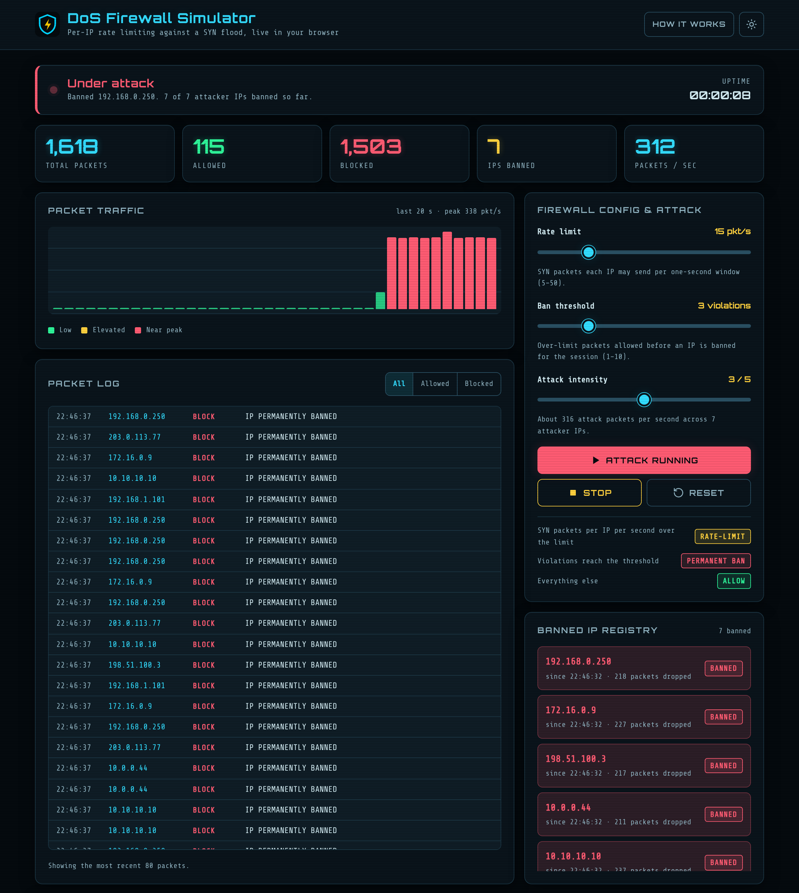
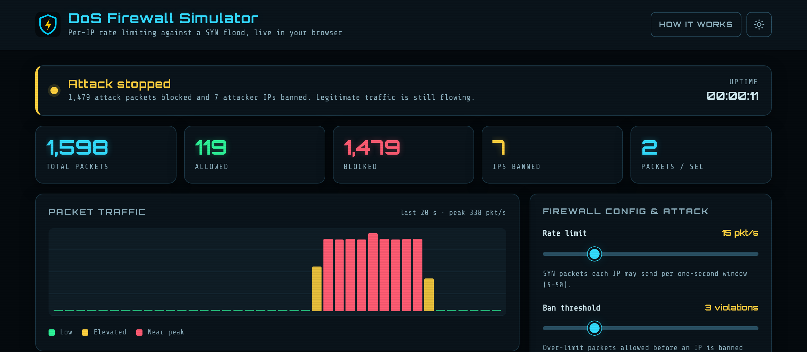
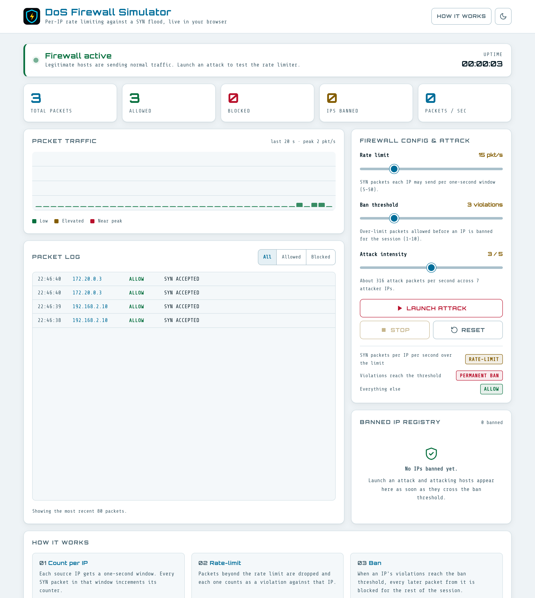
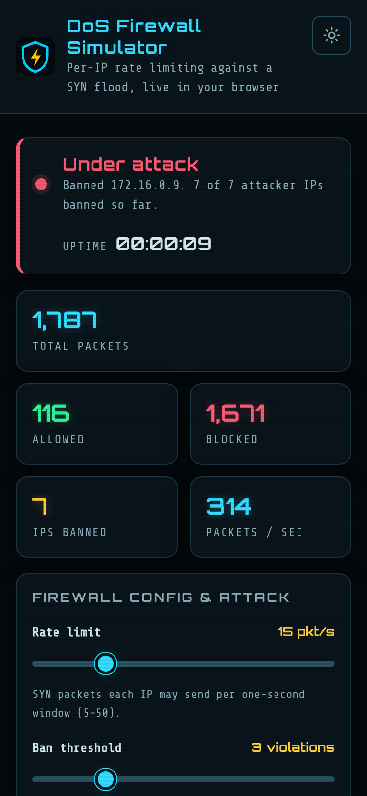
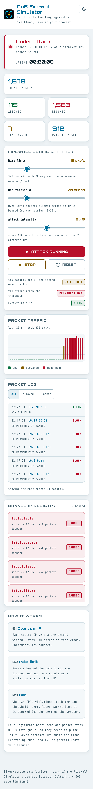
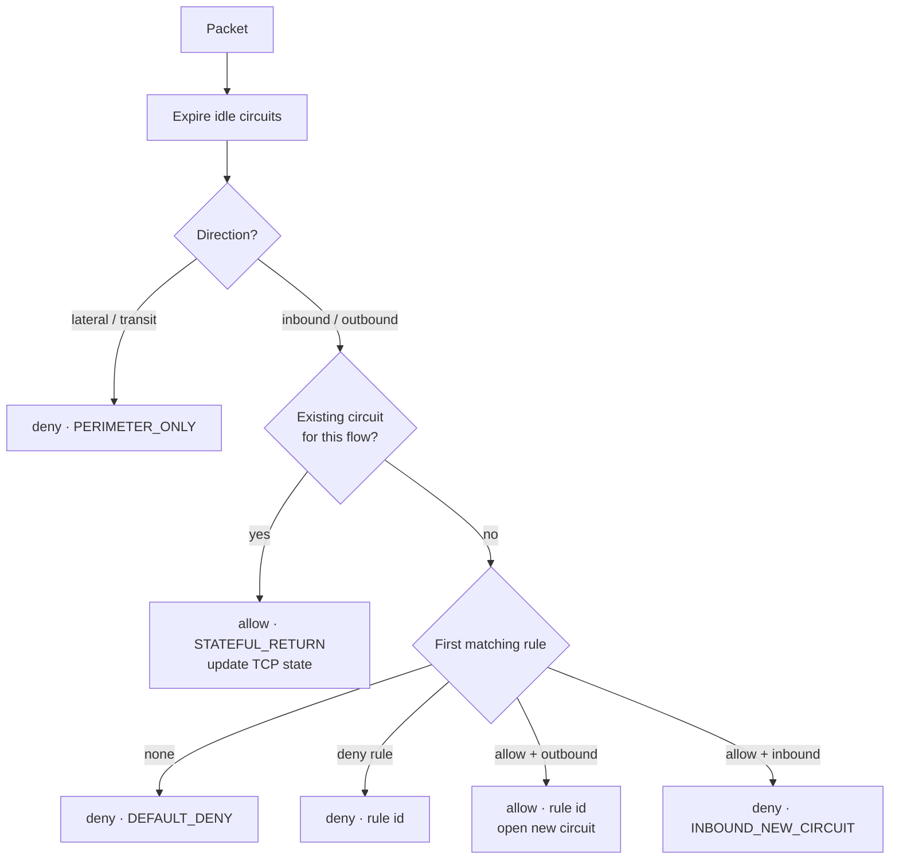
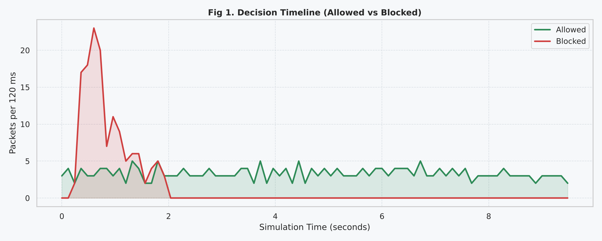
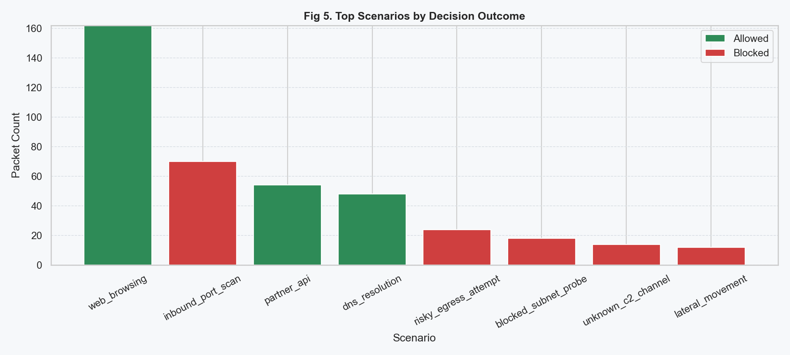

# Firewall Simulations: Circuit-Level Filtering & DoS Rate Limiting


**Two firewall techniques, simulated end to end: a stateful circuit-level firewall replayed against five
attack scenarios in Python, and an interactive browser dashboard where a per-IP rate limiter fights off a
SYN flood.**



---

## Contents

- [Overview](#overview)
- [Screenshots](#screenshots)
- [Features](#features)
- [Tech stack](#tech-stack)
- [Architecture](#architecture)
- [Project structure](#project-structure)
- [Getting started](#getting-started)
- [Configuration](#configuration)
- [Usage](#usage)
- [Command reference](#command-reference)
- [Output reference](#output-reference)
- [Results (seed 2026)](#results-seed-2026)
- [Testing](#testing)
- [Linting and formatting](#linting-and-formatting)
- [Deployment](#deployment)
- [Troubleshooting / FAQ](#troubleshooting--faq)
- [Known limitations](#known-limitations)
- [Roadmap ideas](#roadmap-ideas)
- [Contributing](#contributing)
- [License](#license)

## Overview

Firewalls are usually explained with diagrams. This project lets you watch two of them make decisions,
packet by packet.

| Part | Problem it demonstrates | How you use it |
|---|---|---|
| **Circuit filtering firewall** (`src/`) | How a session-level (OSI layer 5) firewall can admit return traffic for connections opened from inside while rejecting unsolicited inbound sessions, using only L3/L4 metadata and never the payload. | Run one command. It replays a seeded, labelled traffic mix and writes a decision log, metrics, a Markdown report and five figures. |
| **DoS firewall simulator** (`web/`) | How fixed-window, per-source-IP rate limiting with escalating bans stops a SYN flood without cutting off legitimate hosts. | Open a static web page, press **Launch attack**, tune the rate limit, ban threshold and attack intensity, and watch the attackers get banned. |

**Who it's for:** students and instructors in systems and network security courses, anyone preparing for
security interviews or certifications who wants to *see* stateful filtering and rate limiting, and
developers who want a small, readable, fully tested reference implementation to extend.

The two parts are independent. The Python pipeline produces reproducible analysis; the web page is a live
teaching aid with no build step and no dependencies.

## Screenshots

All screenshots were captured from the running web simulator in headless Chromium. The traffic is the
simulator's own synthetic traffic, so no real hosts are involved.

| Attack stopped: summary banner and live chart | Light theme, idle (legitimate traffic only) |
|---|---|
|  |  |

| Phone (375 px), under attack | Phone (375 px), full page, light theme |
|---|---|
|  |  |

Report figures generated by the Python pipeline are shown under [Results](#results-seed-2026).

## Features

### Circuit filtering engine (`src/circuit_firewall.py`)

- **Ordered rules, first match wins.** Each rule matches on direction, protocol, source/destination CIDR and
  destination port list. Anything unmatched falls through to an implicit default deny.
- **Rule validation.** Invalid actions, directions, protocols or out-of-range ports raise `ValueError` when
  the rule is created, not at match time.
- **Circuit (session) table** for TCP and UDP, keyed by the 5-tuple. Return traffic is admitted only for
  circuits opened from the internal network (`STATEFUL_RETURN`).
- **Simplified TCP state machine:** `SYN_SENT → SYN_RECEIVED → ESTABLISHED → CLOSING → CLOSED`, plus
  immediate teardown on `RST`.
- **Idle-circuit expiry** after a configurable timeout (3,200 ms in the reference run).
- **Inbound sessions are never opened,** even if a rule would allow them (`INBOUND_NEW_CIRCUIT`).
- **Perimeter scoping:** internal↔internal (*lateral*) and external↔external (*transit*) traffic is denied
  as `PERIMETER_ONLY`.
- **Unique circuit IDs** (`C-0001`, `C-0002`, …) from a monotonic counter.
- **Full decision record** per packet: decision, rule ID, reason, circuit ID and state, active circuit
  count and processing time.

### Traffic generator and reporting (`src/traffic_simulator.py`, `src/visualize.py`, `src/run_simulation.py`)

- **Seeded, reproducible traffic.** The same seed always produces the same packets.
- **Three benign scenarios:** web browsing (TCP 80/443), partner API calls (TCP 8443 to `198.51.100.0/24`),
  DNS lookups (UDP 53).
- **Five attack scenarios:** inbound port scan, risky egress (Telnet/SMB/RDP), probes from a blocked
  subnet, outbound C2 on an unapproved port, and lateral movement.
- **Ground-truth labels** produce a confusion matrix, detection rate, false-positive rate and accuracy.
- **Outputs:** CSV packet log, per-scenario CSV, JSON summary, Markdown executive summary and five PNG
  figures.
- **Friendly CLI:** `--help` with examples and an output map, a progress line, a results summary, and clear
  errors for an unusable `--output-dir`.

### DoS firewall simulator (`web/`)

- **Fixed-window, per-IP SYN rate limiting** with violation counting and session-long bans
  (`web/rate-limiter.js`, unit tested with `node:test`).
- **Live dashboard:** status banner, five counters, a 20-second traffic chart, a filterable packet log
  (All / Allowed / Blocked) and a banned-IP registry with ban time and dropped-packet counts.
- **Adjustable at runtime:** rate limit (5–50 pkt/s), ban threshold (1–10 violations) and attack intensity
  (1–5, about 61 to 2,000 packets per second). The intensity hint shows the actual packet rate.
- **Clear states:** idle, under attack, attack stopped (with a summary of what was blocked), reset, empty
  log and registry, and an error banner that disables the controls if the engine script fails to load.
- **Dark and light themes.** It follows the system setting on first visit, and a header toggle remembers
  your choice.
- **Accessible:** semantic landmarks and headings, a skip link, labelled sliders with `aria-valuetext`,
  `aria-pressed` on the attack toggle, a polite live region for status changes, visible focus rings,
  44 px touch targets, WCAG AA contrast in both themes, and `prefers-reduced-motion` support.
- **Responsive:** desktop two-column layout, tablet and phone single-column layouts with controls first.
  Checked at 375, 768 and 1280 px with no horizontal scrolling.
- **Fast:** packets are batched and rendered a few times per second, so the page stays smooth at
  2,000 packets per second. No framework, no build step, three small static files plus the engine.

## Tech stack

| Area | Technology | Notes |
|---|---|---|
| Firewall engine | Python 3.10+ standard library | `ipaddress`, `dataclasses`, `itertools`, `collections` |
| Analysis & tables | pandas 2.x | Decision log as a DataFrame, CSV export, metrics |
| Figures | matplotlib 3.x, seaborn 0.13 | Five PNG report figures |
| Web simulator | HTML, CSS (custom properties), vanilla JavaScript | No framework or bundler |
| Web fonts | Orbitron, Share Tech Mono (Google Fonts) | Falls back to system monospace offline |
| Python tests | pytest, pytest-cov (optional) | 30 tests, 99% line coverage |
| JS tests | Node.js built-in `node:test` | 7 tests for the rate-limiter engine |
| Lint / format | ruff | Configured in `pyproject.toml` |
| CI | GitHub Actions | `.github/workflows/ci.yml` |

## Architecture

```mermaid
flowchart LR
    subgraph PY["Python pipeline (src/)"]
        TS["traffic_simulator.generate_traffic(seed)<br/>labelled, time-ordered Packets"]
        FW["circuit_firewall.CircuitFirewall<br/>rules + circuit table"]
        RS["run_simulation.run()<br/>metrics & reports"]
        VZ["visualize.generate_figures()"]
        TS --> FW --> RS
        RS --> VZ
    end
    RS --> R1[("results/<br/>packet log CSV<br/>scenario CSV<br/>summary JSON<br/>executive summary MD")]
    VZ --> R2[("figures/<br/>fig1–fig5 PNG")]

    subgraph WEB["Browser simulator (web/)"]
        GEN["app.js<br/>legit + attack traffic generators"]
        RL["rate-limiter.js<br/>RateLimitFirewall"]
        UI["Dashboard<br/>stats · chart · log · registry"]
        GEN -->|processPacket(ip, t)| RL
        RL -->|ALLOW / BLOCK + reason| GEN
        GEN -->|batched render| UI
    end
```

### Circuit firewall decision path

For every packet, `CircuitFirewall.process_packet()` does the following, in order:



### Default rule set

The internal network is `10.0.0.0/24`. Rules are defined in `build_default_rules()` in
`src/circuit_firewall.py`.

| Rule | Action | Direction | Match | Purpose |
|---|---|---|---|---|
| 201 | deny | inbound | `203.0.113.0/24 → 10.0.0.0/24` | Block a known hostile subnet |
| 202 | deny | outbound | TCP to ports 23, 445, 3389 | Block risky egress services |
| 101 | allow | outbound | TCP to ports 80, 443 | Web browsing |
| 102 | allow | outbound | TCP to `198.51.100.0/24:8443` | Partner API |
| 103 | allow | outbound | UDP to ports 53, 123 | DNS and NTP |
| — | deny | any | no match | Implicit default deny |

### Rate limiter algorithm (web)

For each packet from source IP `ip` at time `t`:

1. If `ip` is banned, block it (`IP PERMANENTLY BANNED`).
2. If `ip` has no window yet, or its window started more than `windowMs` (1,000 ms) ago, start a new
   window with a count of 1 and allow the packet. Violations carry over between windows.
3. Otherwise increment the count. If the count exceeds `rateLimit`, add a violation and block. Once
   violations reach `banThreshold`, ban the IP for the rest of the session.

Four legitimate hosts send one packet every 0.8 s, so they never trip the limit. Seven attacker IPs share
the flood.

## Project structure

```text
.
├── src/                          # Python circuit filtering simulation
│   ├── circuit_firewall.py       #   Packet / Rule / CircuitEntry models, CircuitFirewall engine, default rules
│   ├── traffic_simulator.py      #   Seeded benign + attack traffic generator (ground-truth labels)
│   ├── visualize.py              #   The five report figures (matplotlib + seaborn)
│   └── run_simulation.py         #   CLI: simulate, compute metrics, write CSV / JSON / Markdown / PNG
├── web/                          # Static DoS firewall simulator (open index.html)
│   ├── index.html                #   Markup, meta / Open Graph tags, theme bootstrap
│   ├── styles.css                #   Design tokens (spacing, type, colour per theme) and components
│   ├── app.js                    #   UI controller: traffic generation, batched rendering, controls
│   ├── rate-limiter.js           #   RateLimitFirewall engine (browser global + CommonJS for tests)
│   └── favicon.svg               #   Shield icon (also used as the header logo)
├── tests/
│   ├── conftest.py               #   Shared fixtures
│   ├── test_circuit_firewall.py  #   Rule matching / validation, TCP & UDP lifecycle, expiry, IDs
│   ├── test_simulation.py        #   Determinism, policy correctness, reference numbers, CLI behaviour
│   └── web/rate-limiter.test.js  #   node:test suite for the rate limiter
├── analysis/                     # Committed reference output for seed 2026
│   ├── figures/                  #   fig1–fig5 PNGs
│   └── results/                  #   packet log, scenario breakdown, summary JSON, executive summary
├── docs/
│   ├── implementation_guide.md   #   Deeper walk-through of components and the state machine
│   └── screenshots/              #   README screenshots of the web simulator
├── .github/workflows/ci.yml      # Lint + tests on Python 3.10–3.13, simulation run, JS tests
├── pyproject.toml                # Project metadata, ruff and pytest configuration
├── requirements.txt              # Runtime dependencies
└── requirements-dev.txt          # Runtime + pytest + ruff
```

## Getting started

### Prerequisites

| Tool | Version | Needed for |
|---|---|---|
| Python | 3.10 or newer (CI covers 3.10–3.13) | The circuit filtering simulation and its tests |
| pip + venv | bundled with Python | Installing dependencies |
| Node.js | 18 or newer (CI uses 22) | Only the web rate-limiter unit tests |
| A modern browser | Chrome, Edge, Firefox or Safari | The web simulator |

### Installation

```bash
# 1. Clone
git clone https://github.com/jeevithg090/SNS-Project-.git
cd SNS-Project-

# 2. Create and activate a virtual environment
python -m venv .venv
source .venv/bin/activate            # Windows (PowerShell): .venv\Scripts\Activate.ps1

# 3. Install dependencies
pip install -r requirements-dev.txt  # runtime + pytest + ruff
# or, to only run the simulation:
pip install -r requirements.txt
```

The web simulator needs no installation.

### Run in development

```bash
# Circuit filtering simulation (writes to analysis/)
python src/run_simulation.py

# Web simulator: open web/index.html directly, or serve it locally
python -m http.server --directory web 8000
# then visit http://localhost:8000
```

### "Production" use

There is no server component. "Production" means:

- **Reports:** run `python src/run_simulation.py --seed <n> --output-dir <dir>` and publish or archive the
  output directory. CI does this on every push and uploads the result as the `simulation-reports` artifact.
- **Web simulator:** host the `web/` folder on any static host (see [Deployment](#deployment)).

## Configuration

The project reads **no environment variables** and needs **no secrets**, so there is no `.env` file.

Run-time options are command-line flags:

| Flag | Required | Default | Description |
|---|---|---|---|
| `--seed SEED` | No | `2026` | Random seed for deterministic traffic generation. The same seed always gives the same packets and decisions. |
| `--output-dir DIR` | No | `analysis/` (repository root) | Directory that receives `results/` and `figures/`. Created if missing. Must not be an existing file. |

Policy and network settings are constants in the code:

| Setting | Location | Default | Description |
|---|---|---|---|
| `INTERNAL_CIDR` | `src/run_simulation.py` | `10.0.0.0/24` | The protected internal network |
| `CIRCUIT_TIMEOUT_MS` | `src/run_simulation.py` | `3200` | Idle time before a circuit expires |
| `DEFAULT_SEED` | `src/run_simulation.py` | `2026` | Seed used when `--seed` is omitted |
| Rule set | `build_default_rules()` in `src/circuit_firewall.py` | 5 rules | See [Default rule set](#default-rule-set) |
| `rateLimit` | slider in the web UI | `15` pkt/s | Packets per IP per window |
| `banThreshold` | slider in the web UI | `3` | Violations before a ban |
| `windowMs` | `web/app.js` | `1000` | Rate-limit window length |
| Attacker / legitimate IPs | `ATTACKER_IPS`, `LEGIT_IPS` in `web/app.js` | 7 / 4 addresses | Simulated sources |

## Usage

### 1. Run the circuit filtering simulation

```console
$ python src/run_simulation.py
Running circuit filtering simulation (seed 2026)...

=== CIRCUIT FILTERING FIREWALL SIMULATION ===
Packets: 402 (264 benign, 138 malicious)
Allowed / blocked: 264 / 138
Detection rate: 100.0%
False positive rate: 0.0%
Accuracy: 100.0%
Peak active circuits: 24

Outputs:
  Packet log:    /path/to/SNS-Project-/analysis/results/circuit_packet_log.csv
  Summary JSON:  /path/to/SNS-Project-/analysis/results/simulation_summary.json
  Scenario CSV:  /path/to/SNS-Project-/analysis/results/scenario_breakdown.csv
  Report:        /path/to/SNS-Project-/analysis/results/executive_summary.md
  Figures:       /path/to/SNS-Project-/analysis/figures (5 PNG files)
```

More examples:

```bash
python src/run_simulation.py --seed 42             # a different reproducible traffic mix
python src/run_simulation.py --output-dir out/     # leave the committed analysis/ untouched
python src/run_simulation.py --help                # all options, examples and the output map
```

### 2. Use the engine from Python

```python
import sys

sys.path.insert(0, "src")
from circuit_firewall import CircuitFirewall, Packet, build_default_rules

fw = CircuitFirewall(internal_cidr="10.0.0.0/24", rules=build_default_rules(), circuit_timeout_ms=3200)

syn = Packet(1, 0, "10.0.0.5", "93.184.216.34", 50000, 443, "tcp", "SYN", "benign", "demo")
reply = Packet(2, 15, "93.184.216.34", "10.0.0.5", 443, 50000, "tcp", "SYN-ACK", "benign", "demo")
probe = Packet(3, 20, "203.0.113.9", "10.0.0.5", 4444, 22, "tcp", "SYN", "malicious", "demo")

for packet in (syn, reply, probe):
    d = fw.process_packet(packet)
    print(d["decision"], d["rule_id"], d["reason"], d["circuit_id"])
```

```text
allow 101 Allow outbound web sessions C-0001
allow STATEFUL_RETURN Matched existing circuit table entry C-0001
deny 201 Block known hostile source subnet
```

(The exact `reason` text comes from each rule's `description` in `build_default_rules()`.)

### 3. Use the web simulator

1. Open `web/index.html` (or `http://localhost:8000` if you are serving it). Legitimate traffic starts
   right away and the status banner shows **Firewall active**.
2. Optionally adjust **Rate limit**, **Ban threshold** and **Attack intensity**. The hint under intensity
   shows the resulting attack packet rate.
3. Press **Launch attack**. The banner turns red, the chart spikes, and each attacker IP appears in the
   **Banned IP registry** once it reaches the ban threshold, along with its ban time and dropped-packet
   count.
4. Use the **All / Allowed / Blocked** filter to check that legitimate hosts are still getting through.
5. Press **Stop** (or **Launch attack** again, which works as a toggle). The banner summarises how many
   attack packets were blocked and how many IPs were banned.
6. **Reset** clears counters, bans and the log. The sun/moon button switches between dark and light themes.

Keyboard: <kbd>Tab</kbd> moves through the skip link, header, sliders, buttons, log filter, log and
registry. Sliders respond to arrow keys, <kbd>Home</kbd> and <kbd>End</kbd>.

### 4. Use the rate-limiter engine on its own

```js
const { RateLimitFirewall } = require('./web/rate-limiter.js');

const fw = new RateLimitFirewall({ rateLimit: 2, banThreshold: 2, windowMs: 1000 });
for (let i = 0; i < 5; i++) console.log(fw.processPacket('198.51.100.3', 0));
```

```text
{ action: 'ALLOW', reason: 'SYN ACCEPTED', ip: '198.51.100.3' }
{ action: 'ALLOW', reason: 'SYN ACCEPTED', ip: '198.51.100.3' }
{ action: 'BLOCK', reason: 'RATE EXCEEDED (3/2 pkt/s)', ip: '198.51.100.3' }
{ action: 'BLOCK', reason: 'BANNED after 2 violations', ip: '198.51.100.3' }
{ action: 'BLOCK', reason: 'IP PERMANENTLY BANNED', ip: '198.51.100.3' }
```

## Command reference

| Command | What it does |
|---|---|
| `pip install -r requirements-dev.txt` | Install runtime and development dependencies |
| `python src/run_simulation.py [--seed N] [--output-dir DIR]` | Run the simulation and write all reports |
| `python src/run_simulation.py --help` | Show options, examples and the output map |
| `python -m http.server --directory web 8000` | Serve the web simulator at `http://localhost:8000` |
| `pytest` | Run the Python test suite |
| `pytest --cov=src` | The same, with a coverage report (needs `pip install pytest-cov`) |
| `node --test tests/web/*.test.js` | Run the rate-limiter unit tests |
| `ruff check .` | Lint |
| `ruff format .` / `ruff format --check .` | Format / check formatting |

## Output reference

Everything is written under `--output-dir` (default `analysis/`):

| File | Contents |
|---|---|
| `results/circuit_packet_log.csv` | One row per packet: `event_id, time_ms, label, scenario, direction, src_ip, dst_ip, src_port, dst_port, protocol, flags, decision, rule_id, reason, circuit_id, circuit_state, active_circuits, processing_ms` |
| `results/scenario_breakdown.csv` | Packet counts per `scenario, label, decision` |
| `results/simulation_summary.json` | Totals, allow/block rates, detection / false-negative / false-positive rates, accuracy, confusion matrix, processing-time stats, circuit stats, rule hits, figure paths (relative) |
| `results/executive_summary.md` | A short Markdown report with the key metrics |
| `figures/fig1_decision_timeline.png` | Allowed vs. blocked decisions over time |
| `figures/fig2_circuit_utilization.png` | Active circuit-table entries over time |
| `figures/fig3_rule_hit_distribution.png` | How often each rule / decision reason fired |
| `figures/fig4_decision_matrix.png` | Confusion matrix of ground-truth label vs. decision |
| `figures/fig5_scenario_breakdown.png` | Outcome per traffic scenario |

Sample row from the packet log:

```csv
event_id,time_ms,label,scenario,direction,src_ip,dst_ip,src_port,dst_port,protocol,flags,decision,rule_id,reason,circuit_id,circuit_state,active_circuits,processing_ms
1,62,benign,web_browsing,outbound,10.0.0.13,192.0.2.44,56474,80,tcp,SYN,allow,101,Allow outbound web sessions,C-0001,SYN_SENT,1,0.08054
```

## Results (seed 2026)

These numbers come from the committed `analysis/results/simulation_summary.json` and are reproduced exactly
by `python src/run_simulation.py --seed 2026` (a test enforces them). Processing times vary by machine.

| Metric | Value |
|---|---|
| Packets simulated | 402 (264 benign, 138 malicious) |
| Allowed / blocked | 264 / 138 |
| Detection rate | 100.0% |
| False-positive rate | 0.0% |
| Peak active circuits | 24 |
| Rule hits | `STATEFUL_RETURN` 218 · `DEFAULT_DENY` 84 · 202: 24 · 103: 24 · 201: 18 · 101: 16 · `PERIMETER_ONLY` 12 · 102: 6 |

Per scenario:

| Scenario | Label | Decision | Packets |
|---|---|---|---|
| web_browsing | benign | allow | 162 |
| partner_api | benign | allow | 54 |
| dns_resolution | benign | allow | 48 |
| inbound_port_scan | malicious | deny | 70 |
| risky_egress_attempt | malicious | deny | 24 |
| blocked_subnet_probe | malicious | deny | 18 |
| unknown_c2_channel | malicious | deny | 14 |
| lateral_movement | malicious | deny | 12 |

> The traffic is synthetic and the rule set was written for it, so the perfect scores show that the policy
> and state machine behave as designed. They are **not** a benchmark against real-world traffic.

| | |
|---|---|
|  |  |
|  |  |



## Testing

```bash
pytest                              # 30 Python tests
pytest --cov=src                    # with coverage (99% line coverage)
node --test tests/web/*.test.js     # 7 rate-limiter tests
```

What is covered:

| Suite | Covers |
|---|---|
| `tests/test_circuit_firewall.py` | Rule matching on direction / protocol / CIDR / port, wildcard ports, case-insensitivity, rejection of invalid rules and timeouts, TCP handshake → established → FIN/ACK close, RST teardown, unsolicited inbound denial, inbound allow rules not opening circuits, the blocked-subnet and risky-egress rules, partner API scoping, UDP DNS exchange, lateral / transit rejection, idle expiry, unique circuit IDs after reuse, rule-hit counting |
| `tests/test_simulation.py` | Traffic determinism per seed, time ordering and sequential IDs, zero false positives / negatives across seeds 1, 42 and 2026, the documented reference numbers, an end-to-end CLI run into a temp directory (all artifacts, relative figure paths), CLI rejection of a file as `--output-dir`, and `--help` content |
| `tests/web/rate-limiter.test.js` | Allowing up to the limit, blocking over it, banning at the threshold, window reset with persistent violations, per-IP independence, runtime setting changes, reset |

The web UI itself (`app.js`) was checked by driving it in headless Chromium with Playwright at 375, 768 and
1280 px in both themes: launching, stopping and resetting, the log filter, keyboard tab order, the
engine-failed-to-load error state, horizontal overflow, touch-target sizes and console errors. That
script is not part of the repository's test suite.

## Linting and formatting

Python uses [ruff](https://docs.astral.sh/ruff/) for linting and formatting, configured in
`pyproject.toml` (line length 120, target Python 3.10, rule sets `E F W I B UP SIM RUF`).

```bash
ruff check .            # lint
ruff check . --fix      # lint and auto-fix
ruff format .           # format
```

There is no JavaScript linter configured. The web code is small, dependency-free and covered by the
`node:test` suite.

## Deployment

### Web simulator (static hosting)

`web/` is a self-contained static site: `index.html`, `styles.css`, `app.js`, `rate-limiter.js` and
`favicon.svg`. All paths are relative, so it works from any sub-path.

- **GitHub Pages:** GitHub Pages can only publish from the repository root or a `/docs` folder on a branch,
  or through a custom Actions workflow. The simplest option is a separate `gh-pages` branch whose root
  holds the contents of `web/`. Then set *Settings → Pages → Source* to that branch.
- **Netlify / Vercel / Cloudflare Pages:** create a site from the repository, leave the build command
  empty and set the publish directory to `web`.
- **Any web server:** copy the five files into a directory it serves.

The only external request is to Google Fonts. Without it the page falls back to system monospace fonts and
works the same.

### Reports

CI (`.github/workflows/ci.yml`) runs the simulation on every push and pull request and uploads the
output as the `simulation-reports` artifact. To update the committed reference copy, run
`python src/run_simulation.py --seed 2026` locally and commit `analysis/`. The run timestamp and timing
fields always change, so only commit when results actually change.

## Troubleshooting / FAQ

**`ModuleNotFoundError: No module named 'pandas'` (or matplotlib / seaborn)**
Dependencies aren't installed in the interpreter you are using. Activate the virtual environment and run
`pip install -r requirements.txt`. `python -c "import sys; print(sys.executable)"` shows which Python is
active.

**`ModuleNotFoundError: No module named 'circuit_firewall'` when importing from my own script**
The modules live in `src/` and aren't an installed package. Run scripts from the repository root and add
`src` to the path (`sys.path.insert(0, "src")`), or set `PYTHONPATH=src`. `pytest` already does this
through `pyproject.toml`.

**`error: --output-dir … exists and is not a directory`**
You passed a path to an existing file. Point `--output-dir` at a directory (it is created if missing).

**Running the simulation changed files in `analysis/`**
That is the default output location. Use `--output-dir out/` (or any scratch directory) to leave the
committed reference output alone, or discard the changes with `git checkout -- analysis/`.

**Matplotlib complains about a display or backend on a headless server**
Figures are only saved to files, never shown. If your environment forces an interactive backend, set
`MPLBACKEND=Agg` before running.

**The web page shows "The firewall engine failed to load"**
`rate-limiter.js` must sit next to `index.html`. This usually happens after copying only `index.html` to
a host. Copy the whole `web/` folder.

**The fonts look plain or different**
Google Fonts is blocked or you are offline. The page falls back to your system's monospace font, and
everything still works.

**Legitimate hosts never get banned. Is that a bug?**
No. They send one packet every 0.8 s, well below the minimum rate limit of 5 pkt/s. To see collateral
damage you would need to change `LEGIT_INTERVAL_MS` in `web/app.js`.

**Why do the counters keep growing after I press Stop?**
The four legitimate hosts keep sending traffic, just as a real network would. Press **Reset** to clear
everything.

**Why does `--seed 2026` reproduce the numbers exactly but `processing_ms` differs?**
Decisions are deterministic. Processing time is measured wall-clock time and depends on your machine.

## Known limitations

- **Synthetic traffic only.** Packets are generated, not captured, and the rule set was written to match
  the generator, which is why detection is 100%.
- **Simplified TCP.** The state machine ignores sequence numbers, windowing, retransmission and
  simultaneous open, and UDP "circuits" are pseudo-sessions keyed by 5-tuple plus timeout.
- **No NAT, IPv6 policy or fragmentation handling** in the circuit firewall.
- **Hard-coded policy.** Rules and network settings live in Python constants; there is no config file.
- **The web simulator is a teaching model.** The SYN flood is simulated inside the browser, bans last
  until reset, the rate limiter uses fixed windows (which allow bursts at window edges), and source IPs
  aren't spoofed, which a real SYN flood often does.
- **Browser coverage.** The UI was verified in Chromium. Firefox and Safari use standard CSS and APIs but
  weren't tested by hand, and accessibility was checked through markup review and keyboard testing, not
  with a screen reader.

## Roadmap ideas

- Load rules and network settings from a YAML/JSON policy file.
- Replay real metadata from PCAP files instead of synthetic traffic.
- Add NAT and IPv6 support to the circuit firewall.
- Stress-test circuit timeouts and table capacity (eviction policy, SYN-flood pressure on the table).
- Offer sliding-window or token-bucket algorithms in the web simulator, plus temporary (time-boxed) bans.
- Simulate spoofed-source floods to show where per-IP limits stop working, and add SYN cookies as a
  counter-measure.
- Add ESLint and a Playwright smoke test to CI if the web part grows.

## Contributing

1. Fork the repository and create a feature branch.
2. Install the dev dependencies: `pip install -r requirements-dev.txt`.
3. Make your change with tests. If you change firewall behaviour, update the reference numbers in
   `tests/test_simulation.py` and the README results on purpose, not by accident.
4. Run the full check before opening a pull request:
   ```bash
   ruff check . && ruff format --check . && pytest && node --test tests/web/*.test.js
   ```
5. For web UI changes, check the page at phone (~375 px) and desktop widths in both themes, and use only the
   design tokens in `web/styles.css` instead of raw colours or spacing.
6. Use [Conventional Commits](https://www.conventionalcommits.org/) (`feat:`, `fix:`, `docs:`, …).

## License

This repository does not include a license file yet, so by default all rights are reserved by the author.
If you intend others to reuse the code, adding a permissive license such as **MIT** is recommended. Until
then, please ask the repository owner before reusing it.

## Further reading

[`docs/implementation_guide.md`](docs/implementation_guide.md) walks through the components, the circuit
state machine, the decision algorithm and extension ideas in more depth.
