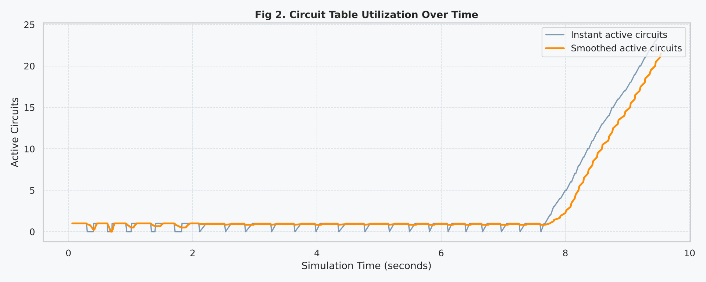
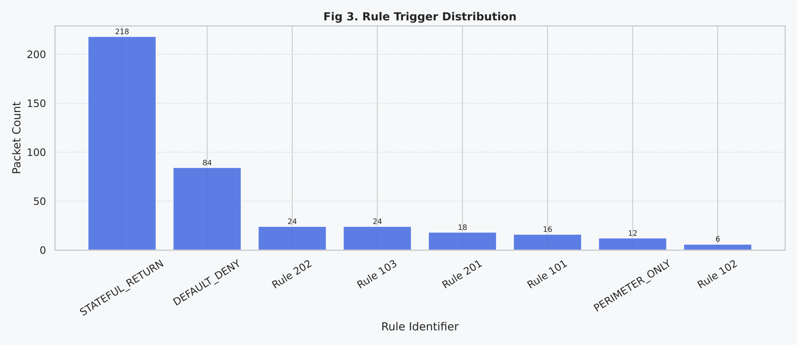
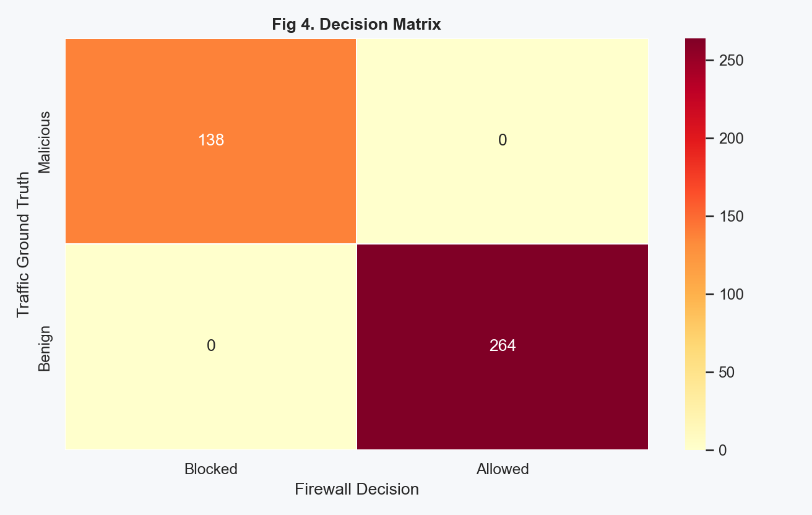

# Firewall Simulations: Circuit-Level Filtering & DoS Rate Limiting

A systems-and-network-security project that models two classic firewall techniques end to end:

1. **Circuit filtering firewall (Python).** A stateful, session-level firewall that decides from Layer 3/4
   metadata only (addresses, ports, protocol, TCP flags) and never inspects payloads. It replays a
   deterministic mix of benign traffic and five attack scenarios, then writes a packet-by-packet decision log,
   metrics and five report figures.
2. **DoS firewall simulator (browser).** An interactive dashboard where you start a SYN flood and watch a
   per-IP rate limiter block and then ban the attacking hosts while legitimate traffic keeps flowing.

The two parts are independent: the Python pipeline produces reproducible analysis, and the web page is a live
teaching aid.

## Features

**Circuit filtering engine**

- Ordered allow/deny rules with CIDR, protocol and port matching. First match wins and anything unmatched is
  denied.
- A circuit (session) table for TCP and UDP. Return traffic is admitted only for sessions opened from the
  internal network.
- Simplified TCP state tracking (`SYN_SENT → SYN_RECEIVED → ESTABLISHED → CLOSING → CLOSED`, plus `RST`
  teardown) and idle-circuit expiry.
- Inbound sessions are never opened, even if a rule allows them. Traffic that doesn't cross the perimeter
  (internal↔internal *lateral* or external↔external *transit*) is rejected as out of scope.
- Every decision is logged with the matching rule, a reason, the circuit ID and state, the active circuit
  count and the processing time.

**Traffic and reporting**

- Seeded, reproducible traffic: web browsing, partner API calls and DNS lookups, mixed with an inbound port
  scan, risky egress (Telnet/SMB/RDP), probes from a blocked subnet, outbound C2 on an unapproved port and
  lateral movement.
- Ground-truth labels give a confusion matrix, detection rate, false-positive rate and accuracy.
- Outputs: a CSV packet log, a per-scenario CSV, a JSON summary, a Markdown executive summary and five PNG
  figures.

**DoS simulator (web)**

- Fixed-window per-IP SYN rate limiting with violation counting and permanent bans.
- Live packet log, banned-IP registry, traffic chart and adjustable rate limit, ban threshold and attack
  intensity.
- Responsive layout, keyboard-accessible controls, screen-reader labels and reduced-motion support. No build
  step or dependencies.

## Tech stack

| Area | Tools |
|---|---|
| Simulation engine | Python 3.10+ (standard library: `ipaddress`, `dataclasses`) |
| Analysis & figures | pandas, matplotlib, seaborn |
| Web simulator | Plain HTML/CSS/JavaScript |
| Quality | pytest, ruff (lint + format), Node's built-in `node:test` |
| CI | GitHub Actions |

## Architecture

```text
traffic_simulator.generate_traffic(seed)      ──►  list[Packet]   (labelled, time-ordered)
                │
                ▼
circuit_firewall.CircuitFirewall.process_packet  ──►  Decision per packet
   1. expire idle circuits
   2. classify direction (inbound / outbound / lateral / transit)
   3. existing circuit?   ── yes ──► allow (STATEFUL_RETURN), update TCP state
   4. ordered rules        ── allow + outbound ──► open circuit
                           ── allow + inbound  ──► deny (INBOUND_NEW_CIRCUIT)
                           ── no match         ──► deny (DEFAULT_DENY)
                │
                ▼
run_simulation.run()  ──►  results/*.csv, *.json, *.md  +  visualize.generate_figures() ──► figures/*.png
```

### Default rule set

The internal network is `10.0.0.0/24`.

| Rule | Action | Direction | Match | Purpose |
|---|---|---|---|---|
| 201 | deny | inbound | `203.0.113.0/24 → 10.0.0.0/24` | Block a known hostile subnet |
| 202 | deny | outbound | TCP to ports 23, 445, 3389 | Block risky egress services |
| 101 | allow | outbound | TCP to ports 80, 443 | Web browsing |
| 102 | allow | outbound | TCP to `198.51.100.0/24:8443` | Partner API |
| 103 | allow | outbound | UDP to ports 53, 123 | DNS and NTP |
| — | deny | any | no match | Implicit default deny |

## Getting started

### Prerequisites

- Python 3.10 or newer
- Node.js 18 or newer (only needed to run the web simulator's unit tests)
- Any modern browser for the web simulator

### Install

```bash
python -m venv .venv
source .venv/bin/activate          # Windows: .venv\Scripts\activate
pip install -r requirements-dev.txt   # or requirements.txt for runtime only
```

### Run the circuit filtering simulation

```bash
python src/run_simulation.py                    # seed 2026, writes to analysis/
python src/run_simulation.py --seed 42          # a different reproducible run
python src/run_simulation.py --output-dir out/  # write results somewhere else
```

### Open the DoS simulator

Open `web/index.html` in a browser. To serve it locally instead:

```bash
python -m http.server --directory web 8000   # then visit http://localhost:8000
```

### Configuration

The project reads no environment variables and needs no secrets. Simulation parameters are command-line flags
(`--seed`, `--output-dir`). Policy and network settings are constants in the code: the rules are in
`build_default_rules()` in `src/circuit_firewall.py`, and `INTERNAL_CIDR` and `CIRCUIT_TIMEOUT_MS` are in
`src/run_simulation.py`.

## Testing & quality

```bash
pytest                              # Python unit + pipeline tests
node --test tests/web/*.test.js     # web rate-limiter tests
ruff check . && ruff format --check .
```

The Python tests cover rule matching and validation, the full TCP/UDP circuit lifecycle, expiry, unique
circuit IDs, the reproducibility of the traffic generator, and an end-to-end CLI run into a temporary
directory. CI runs lint and tests on Python 3.10–3.13, runs the simulation and uploads the generated
reports as a build artifact, and runs the JavaScript tests.

## Results (seed 2026)

These numbers come from the committed `analysis/results/simulation_summary.json` and are reproduced by
`python src/run_simulation.py --seed 2026`. Per-packet processing times change from machine to machine.

| Metric | Value |
|---|---|
| Packets simulated | 402 (264 benign, 138 malicious) |
| Allowed / blocked | 264 / 138 |
| Detection rate | 100.0% |
| False-positive rate | 0.0% |
| Peak active circuits | 24 |

The traffic is synthetic and the rule set is built to match it, so the perfect scores show that the policy
and the state machine behave as designed. They are not a benchmark against real-world traffic.

Figures in `analysis/figures/`:

| | |
|---|---|
|  |  |
|  |  |


## Deployment

Nothing here runs as a server. Two ways to share the project:

- **Web simulator:** `web/` is a static site (`index.html` + `rate-limiter.js`) and can be hosted as-is on
  GitHub Pages, Netlify or any static host. Point the host at the `web/` directory.
- **Reports:** each CI run uploads freshly generated reports as the `simulation-reports` artifact. To update
  the committed copies, run the simulation locally and commit `analysis/`.

## Project structure

```text
.
├── src/
│   ├── circuit_firewall.py    # Packet/Rule models, CircuitFirewall engine, default rule set
│   ├── traffic_simulator.py   # Seeded benign + attack traffic generator
│   ├── visualize.py           # The five report figures
│   └── run_simulation.py      # CLI: simulate, compute metrics, write reports
├── web/
│   ├── index.html             # Interactive DoS firewall simulator
│   └── rate-limiter.js        # Per-IP rate limiting / ban engine
├── tests/
│   ├── test_circuit_firewall.py
│   ├── test_simulation.py
│   └── web/rate-limiter.test.js
├── analysis/                  # Committed reference output (seed 2026)
│   ├── figures/
│   └── results/
├── docs/implementation_guide.md
├── .github/workflows/ci.yml
├── pyproject.toml             # ruff + pytest configuration
├── requirements.txt
└── requirements-dev.txt
```

## Further reading

`docs/implementation_guide.md` covers the components, the circuit state machine, the decision algorithm and
ideas for extending the project (NAT, PCAP replay, timeout stress tests).
